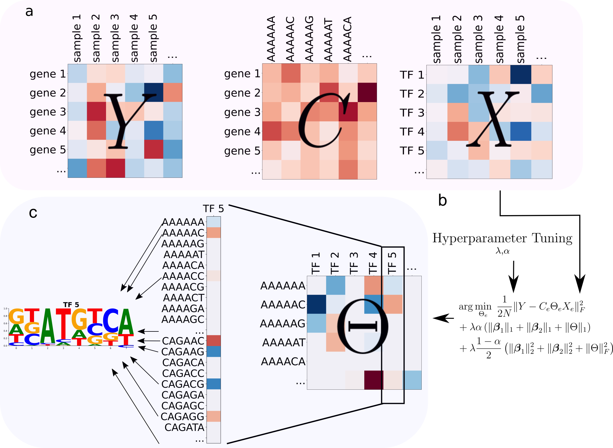
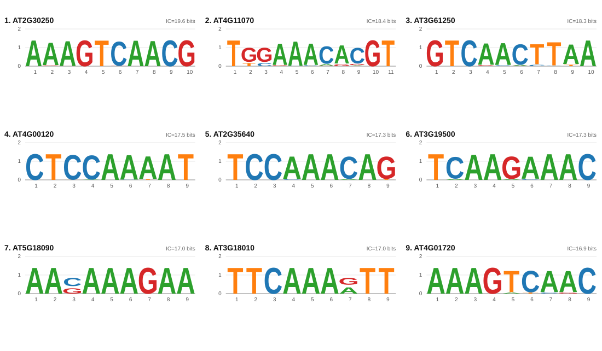

# 🧬 Bilinear Regulatory Inference from DNA and Gene Expression (BRIDGE) 🧬
Predict transcription factor binding motifs de novo from RNA-seq



## 🔍 What is this?
Transcription factors (TFs) regulate gene expression by binding specific DNA sequences in promoters — but figuring out which TFs bind where, and how that shapes expression, usually requires separate computational approaches: gene regulatory network (GRN) inference for TF-gene relationships, or sequence-to-expression (S2E) models for cis-regulatory motifs. These are typically fit independently per gene or condition, obscuring shared regulatory structure.

BRIDGE unifies both into a single convex optimization problem. It factorizes gene expression as an explicit interaction between promoter k-mers (cis) and TF abundance (trans), recovering both regulatory network structure and de novo TF binding motifs (TFBMs) from the same model — with a guaranteed unique global optimum.

BRIDGE only needs RNA-seq data, a genome (FASTA), and an annotation (GFF), data you likely already have if you're doing transcriptomics, and infers TF-specific TFBMs without prior motif libraries or additional wet-lab assays.

## 🛠️ Installation

Before starting, ensure the following tools are installed:
- [`BEDTools`]
- [`SAMtools`]
- [`BLASTp`]
- [`TOMTOM` (meme suite)]

1. Clone the repository
2. (Recommended) Create and activate a virtual environment. For example:
```bash
conda create -n bridge python=3.12 -y
conda activate bridge
```
3. Install the package in editable mode
```bash
pip install --upgrade pip
pip install -e .
```
This installs the `bridge` package (from `src/bridge`) along with its dependencies, and lets you edit the source code without reinstalling.

## 🔬 Usage Demo: RNA-seq + DNA → Inferred TF-Specific Binding Motifs (.MEME)

1. Download the data and generate the X (TFs x samples), Y (Target genes x samples) and C (Target genes x k-mers) matrices.
```bash
bash demo/donwload_data.sh
python demo/generate_XYC.py
```
The above generates the necessary data to use BRIDGE on a Pattern Triggered Immunity (PTI) dataset for *Arabidopsis Thaliana* (see https://pmc.ncbi.nlm.nih.gov/articles/PMC7610817/). It generates the required dataframes .csv in the demo folder. Then, to obtain a .meme with the TFs and their motifs:

```python
import pandas as pd
import matplotlib.pyplot as plt
import numpy as np

from bridge.model.bsr import BSR
from bridge.utils.utils import (
    get_parameter_importance,
    handle_theta_names,
)

from bridge.motif.motif_construction import (
    generate_meme_file,
    generate_PWM_from_theta,
)

# Good hyperparameters from the manuscript 
# (otherwise use src/bridge/hyperparam_tuning functionality, with test/train sets and so on, see: src/bridge/training/train_bsr.py)
alpha = 0.305 
lambd=0.008

X = pd.read_csv("demo/X.csv", index_col=0) # TFs x samples (e.g. Log2FC)
Y = pd.read_csv("demo/Y.csv", index_col=0) # Target genes x samples (e.g. Log2FC)
C = pd.read_csv("demo/C.csv", index_col=0) # Target genes x 6-mers (e.g. vectors of 6-mer counts)

BSR_model = BSR(
        X=X.values,
        Y=Y.values,
        C=C.values,
        max_iter=5000,
        tol=1e-4,
        lambd=lambd,
        alpha=alpha
    )

Theta = BSR_model.fit()

names = handle_theta_names(
            Theta, X.index.to_list(), C.columns.to_list()
        )
hessian = BSR_model.get_hessian()
importance_df, importance_matrix = get_parameter_importance(
    hessian, Theta, names
)
importance_matrix_df = pd.DataFrame(
            importance_matrix[1:, 1:],
            columns=X.index.to_list(),
            index=C.columns.to_list(),
        )
PWM_dict, _ = generate_PWM_from_theta(importance_matrix_df)
generate_meme_file(PWM_dict, meme_path="demo/motifs.meme")

```



## 📊 Manuscript's figure reproduction
See [`REPRODUCE.md`](REPRODUCE.md) for full instructions (data download, preprocessing, and per-figure scripts).

[](https://doi.org/10.5281/zenodo.24399265)
